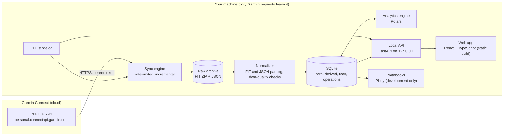
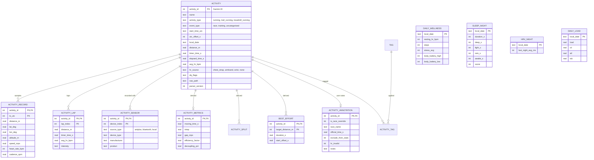

# stridelog: Project Plan

Local-first running analytics for your Garmin data. stridelog mirrors your runs and wellness data from Garmin Connect into a local database. It provides the analyses Strava keeps behind its subscription, and more, all calculated transparently on your own machine.

| Item | Value |
| --- | --- |
| Status | Phase 0 complete, including workspace rename. Phase 1 approved; public-source discovery recorded, private verification pending. |
| Owner | Christos Lathourakis |
| Last updated | 2026-11-17 |
| Repository | `stridelog` on your personal GitHub account (public, MIT), created in Phase 0 |

**How to use this plan.** This plan will change as the project goes on. Each phase becomes a GitHub milestone and each task becomes an issue. Before a phase starts, we write a short implementation plan for it and you approve it, as `.github/copilot-instructions.md` requires. Important decisions are recorded as ADRs (architecture decision records, Section 9.5). When a decision changes, the ADR and this plan are updated in the same pull request.

## Contents

1. [Summary](#1-summary)
2. [Goals, non-goals and success criteria](#2-goals-non-goals-and-success-criteria)
3. [Research findings](#3-research-findings-as-of-2026-11-17)
4. [Requirements](#4-requirements)
5. [Architecture](#5-architecture)
6. [Data model](#6-data-model)
7. [Analytics methodology](#7-analytics-methodology)
8. [Technology stack and dependencies](#8-technology-stack-and-dependencies)
9. [Engineering practices](#9-engineering-practices)
10. [Phased roadmap](#10-phased-roadmap)
11. [Git and GitHub runbook](#11-git-and-github-runbook)
12. [Risk register](#12-risk-register)
13. [Phase 1 verification checklist](#13-phase-1-verification-checklist)
14. [Backlog after v1.0](#14-backlog-after-v10)
15. [Glossary](#15-glossary)
16. [References](#16-references)

---

## 1. Summary

stridelog is a single-user application that runs only on your machine. It does five things:

1. **Sync**: downloads running activities (original FIT files plus Garmin's JSON summaries) and daily wellness data through Garmin's official **Connect Personal API**.
2. **Archive**: keeps every downloaded file unchanged, so the database can always be rebuilt without contacting Garmin again.
3. **Store**: loads the data into one **SQLite** database with typed tables and versioned migrations.
4. **Analyze**: calculates splits, best efforts, heart-rate zones, grade-adjusted pace, training load (fitness, fatigue, form), race predictions, aerobic efficiency and recovery trends with **Polars**.
5. **Serve**: shows everything in a **React + TypeScript** web app, backed by a local **FastAPI** server and built for fast loading and interactive charts and maps.

Nothing is hosted. Apart from the requests to Garmin, no data leaves your machine.

### 1.1 Decisions made so far

| Topic | Decision | Rationale |
| --- | --- | --- |
| Name | `stridelog` for the repository and the Python package | Neutral; does not suggest any link to Strava or Garmin |
| Data source | Garmin Connect Personal API only | Official and supported by Garmin; no stored password; no login rate limits (Section 3.1) |
| v1 data scope | Running activities; resting HR, HRV and sleep; Body Battery, stress and steps | Other sports and weight move to later phases |
| Race tagging | Garmin's activity Event Type "Race", with local overrides | You already tag races in Garmin Connect |
| Units | Metric on screen; SI units in storage | |
| Storage | Raw archive (FIT ZIP files and JSON) plus one SQLite database | Reproducible and needs no maintenance |
| Analytics | Python 3.14 with Polars | Fast and expressive, in a language you already know |
| Backend | FastAPI, listening on 127.0.0.1 only | Typed API with an OpenAPI contract for the frontend |
| Frontend | React + TypeScript once Node.js is available; Jupyter + Plotly notebooks for visual checks until then | No throwaway UI (Gate G1, Section 10) |
| Repository | Public on your personal GitHub, MIT license, GitHub flow with pull requests and required CI checks | Professional workflow from the first commit |

### 1.2 Roadmap at a glance

| Phase | Name | Outcome | Size | Release |
| --- | --- | --- | --- | --- |
| 0 | Foundation | Public repository with tooling, CI, protected `main` and documentation skeleton | S | - |
| 1 | Discovery spike | Confirmed facts about the Personal API and your FIT files; ADRs accepted | S | - |
| 2 | Ingestion | `stridelog sync` copies runs and wellness data into the raw archive, incrementally | M | - |
| 3 | Storage | Typed, rebuildable SQLite database with data-quality checks | M | v0.1.0 |
| 4 | Analytics | Tested, documented running metrics and validation notebooks | L | v0.2.0 |
| 5 | Local API | FastAPI backend and OpenAPI contract | M | v0.3.0 |
| G1 | Gate | Is Node.js available? Decide how the frontend proceeds | - | - |
| 6 | Web app | React + TypeScript dashboard | L | v0.4.0 |
| 7 | Hardening | Backups, scheduled sync, demo data, documentation | M | v1.0.0 |
| 8 | Advanced features | Heatmap, matched runs, race reports, gear, other sports and more | M or L each | v1.x |

Sizes: S is 1 to 3 focused sessions, M is 4 to 8 and L is 8 to 15, where a session is about 2 to 3 hours. Rough total to v1.0: 40 to 60 sessions.

---

## 2. Goals, non-goals and success criteria

**Goals**

- **G1 Own your data**: a complete, automatic, local copy of your runs and wellness data.
- **G2 Premium analytics you can check**: every metric has a documented formula, references and tests.
- **G3 Fast and interactive**: the web app loads quickly, and charts and maps respond immediately.
- **G4 Professional codebase**: typed, tested, documented and automated, so you can show it publicly.

**Non-goals (for now)**

- Hosting or any cloud deployment, multiple users, social features, segments or leaderboards.
- Writing anything back to Garmin Connect, live tracking, or a mobile app.
- Data sources other than Garmin, such as a Strava import.

**Success criteria for v1.0**

- `stridelog sync` brings everything up to date in under a minute on a typical day, with no manual steps.
- Every run since January 2025 is in the database with splits, laps, zones, best efforts and its heart-rate source. Totals (distance, duration, average heart rate) match Garmin Connect.
- The dashboard shows how your training is going on one screen and loads in under 2 seconds.
- CI passes on Windows and Linux, and the repository history contains no personal data and no secrets.

---

## 3. Research findings (as of 2026-11-17)

### 3.1 Ways to get data out of Garmin Connect

| Option | How it works | Strengths | Weaknesses | Verdict |
| --- | --- | --- | --- | --- |
| **Connect Personal API** (official, launched October 2026) | A personal API key is exchanged for a bearer token on `personal.connectapi.garmin.com`; about 24 hours is the earlier research expectation, not a verified account expiry | Supported by Garmin; no password or MFA (multi-factor sign-in) handling; no login rate limit; original FIT files; wellness data | New (v1.0); covers only part of Garmin's data; the key expires after 30 to 365 days and must be renewed by hand; rate limits undocumented | **Chosen** |
| Unofficial Connect API (`python-garminconnect` 0.3.x, used by GarminDB) | Imitates the sign-in of Garmin's web and mobile apps | All data Garmin shows, including training status, race predictor, gear and personal records | Reverse-engineered and fragile: it broke in March 2026 when Garmin added bot protection, after which the `garth` sign-in library was deprecated. About 4 sign-ins in 40 minutes trigger an HTTP 429 error that also locks you out of the official Garmin app for a while. It is unclear whether it complies with Garmin's terms of use | Rejected |
| Garmin account data export | Garmin account > Data management > Export your data | Complete one-off archive | Manual, slow, not incremental | Contingency only |
| FIT files copied from the watch | Copy the activity folder over USB | Works offline, no cloud dependency | Manual; no Garmin summaries or wellness data | Fallback importer (Should) |

### 3.2 What the Personal API provides

- **Access**: create a key in Garmin Connect on the web, under Settings > Personal API Key. Accept the terms and choose a lifetime of 30, 90, 180 or 365 days. The key is shown only once. It is exchanged for a bearer JWT. Earlier research expects about 24 hours, but the account-issued expiry remains unverified; use the issued `exp` claim rather than a hard-coded lifetime. There is no refresh token, so you exchange the key again when the token expires.
- **Scope**: read-only, and data is only fetched on request (pull-only). Only documented paths respond; everything else returns 404.
- **Official client**: `garmin-connect-personal-api-python` 1.0.0 (Apache-2.0 license, Python 3.12 or newer). It caches tokens and includes a `gc-personal` command-line tool, which Phase 1 uses before any project code exists.

| Data | Path (relative to the base URL) | Notes |
| --- | --- | --- |
| Activity search | `/activitylist-service/activities/search/activities` | Paged (`start`, `limit`), with date and activity-type filters |
| Activity details | `/activity-service/activity/{id}` | Different JSON structure from search (`summaryDTO`, `eventTypeDTO`) |
| Original activity file | `/download-service/files/activity/{id}` | ZIP file containing the FIT file |
| Activity types | `/activity-service/activity/activityTypes/simple` | Listed in the current Swagger page; absent from client 1.0.0 convenience methods/CLI; account access still needs checking |
| Daily summaries | `/usersummary-service/v2/dailysummaries` | Steps, resting HR, stress, Body Battery, intensity minutes |
| Sleep | `/sleep-service/sleep/dailySleepSummariesByDate` | Date-range query |
| HRV | `/hrv-service/hrv/daily/{start}/{end}` | Probably empty for a Forerunner 55 (Section 3.4) |
| Body Battery, stress, steps | Dedicated daily endpoints | Used only if the daily summaries lack a field we need |
| Heart-rate zones | `/biometric-service/heartRateZones/v2` | Your zone settings |
| VO2 max (daily) | `/metrics-service/metrics/maxmet/daily/{start}/{end}` | Listed in current Swagger and upstream client source, but absent from released client 1.0.0 convenience methods/CLI; account access still needs checking |

Phase 1 distinguishes the published client from its newer upstream source.
Verified commands, documented limits and unresolved account checks are recorded
in [the discovery findings](research/personal-api-findings.md). A documented path
or client wrapper is not evidence that an endpoint works for this account.

**Not available** (based on community tests on 2026-10-24): training status, training readiness, endurance and hill scores, Garmin's race predictor, the activity splits (laps) endpoint, goals, body composition and the social profile. Gear and personal records are not in the published endpoint list either.

What this means for stridelog:

1. Laps are stored inside the FIT file, so nothing is lost.
2. Garmin's own scores are replaced by our own documented metrics, which is the purpose of the project anyway.
3. Shoe and gear mileage has to be entered manually (backlog).

**Practical constraints**:

- Garmin publishes no rate limit and sends no rate-limit headers. We send about 1 request per second, wait longer and longer after 429 and 5xx errors, and follow the `Retry-After` header.
- Current Swagger documents up to 1 year for daily summaries, 31 days for sleep summaries and Body Battery, and 28 days for steps and stress. These are documented limits, not account-tested boundaries; inclusive counting, HRV limits and observed behavior still need verification.
- The key has to be renewed by hand at least once a year.

### 3.3 GarminDB review

[GarminDB](https://github.com/tcgoetz/GarminDB) is GPL-2.0 licensed, has about 3.4k stars and was still active in November 2026. It downloads data with `python-garminconnect`, keeps the JSON and FIT files, imports them into several SQLite databases and uses Jupyter notebooks for analysis. Credentials go in a JSON config file.

| Keep (as ideas; no code is copied) | Do differently |
| --- | --- |
| Keep the raw files, so the database can be rebuilt without downloading again | Official API key instead of a stored password |
| Re-download a short recent window to catch partial days and later edits | One database with Alembic migrations, with your own entries kept apart so a rebuild never loses them |
| Refresh an activity when Garmin's last-update timestamp changes | Typed, tested code with CI on Windows and Linux |
| Pause between requests and stop when rate-limited | Running-specific analytics with documented formulas, data-quality checks and heart-rate source tracking |
| | An API and a web app instead of notebooks only |

Licensing: GarminDB is GPL-2.0, so copying its code would force stridelog to become GPL too. stridelog reuses ideas only, so it can stay MIT-licensed.

### 3.4 Your devices and what the data will contain

| Period (approximate) | Watch | Heart-rate source |
| --- | --- | --- |
| January 2025 to April 2025 | Forerunner 55 | Wrist (optical sensor in the watch) |
| April 2025 to early November 2026 | Forerunner 55 | Chest strap |
| Since November 2026 | Forerunner 55 | COROS armband (optical, worn on the arm) |

**What we expect from the Forerunner 55 (to be confirmed in Phase 1):**

- **No barometric altimeter**: elevation comes from GPS and is noisy, although Garmin Connect may correct the summary totals. We smooth elevation before calculating grade and grade-adjusted pace, and label elevation-based metrics as approximate. Correcting elevation against a terrain model is an optional backlog item.
- **No overnight HRV status**: HRV data will probably be empty, so every wellness field is treated as optional.
- **No running dynamics** (ground contact time, vertical oscillation): out of scope.
- **Running VO2 max estimate**: the watch records it; Phase 1 checks whether the API returns it.
- **Recording interval** (smart recording or every second): checked in Phase 1. The analytics convert everything to one sample per second either way.

**Every FIT file records which sensors were used.** Each file contains `device_info` messages for the watch and every connected sensor, including the connection type (ANT+, Bluetooth or internal), device type (for example heart rate), manufacturer, product and battery status. stridelog classifies each run's heart-rate source as chest strap, armband, wrist or none, and uses it to:

- flag less reliable runs (at running intensity, a wrist sensor can mistake your step rate for your heart rate);
- optionally leave those runs out of heart-rate trends;
- catch erratic readings, such as those likely in the weeks before the chest strap failed.

### 3.5 Existing tools

- **GoldenCheetah** is open-source desktop training-analysis software (GPL). Its source code includes a Personal API client, which confirms that activity lists, FIT downloads, HRV, daily summaries, sleep and weight all work through the API.
- **intervals.icu** and **Runalyze** are hosted analysis services that sync with Garmin. They are useful for feature ideas and for cross-checking our fitness, fatigue and best-effort numbers.

### 3.6 Strava features and their stridelog equivalents

| Strava feature (mostly subscription) | stridelog equivalent | Phase |
| --- | --- | --- |
| Fitness & Freshness | Fitness (CTL), fatigue (ATL) and form (TSB), calculated from heart-rate-based training load (TRIMP) | 4, 6 |
| Relative Effort | Per-run training load, and weekly load compared with your recent range | 4, 6 |
| Best efforts and PR history | Best efforts at standard distances, with progression charts | 4, 6 |
| Performance predictions | Riegel, VDOT and critical-speed predictions, compared with your actual races | 4, 6 |
| Heart-rate and pace zone analysis | Time in each zone per run and per week; intensity distribution | 4, 6 |
| Grade Adjusted Pace | GAP using Minetti's energy-cost model | 4, 6 |
| Progress charts and training log | Weekly, monthly and yearly volume; calendar heatmap | 6 |
| Race analysis | Race list, results and pacing analysis | 6, 8 |
| Matched runs | Repeated routes grouped and compared over time | 8 |
| Personal heatmaps | Heatmap of all runs, with privacy zones | 8 |
| Goals | Weekly volume and race goals | 8 |
| Segments, leaderboards, Beacon, routes, social | Out of scope | - |

---

## 4. Requirements

### 4.1 Functional requirements

Requirements are prioritized with MoSCoW: Must, Should, Could and Won't.

**Must (v1.0)**

| ID | Requirement |
| --- | --- |
| F1 | Incremental sync and full history download of running activities (road, trail, treadmill, track): summary JSON, details JSON and original FIT file |
| F2 | Incremental sync of wellness data: daily summaries (resting HR, steps, stress, Body Battery), sleep, and HRV when available |
| F3 | Raw archive that is never modified; the database can be rebuilt from it at any time |
| F4 | Activity list (filter, sort, search) and activity detail page (map; pace, HR, elevation and cadence charts; splits; laps; zones; sensors) |
| F5 | Trends: weekly, monthly and yearly volume; pace, heart rate, efficiency and cadence over time |
| F6 | Best efforts at standard distances, personal records and their progression |
| F7 | Races: list built from Garmin's race flag plus your overrides, with results and personal bests |
| F8 | Training load: load per run; fitness (CTL), fatigue (ATL) and form (TSB) |
| F9 | Recovery view: resting HR, sleep, Body Battery, stress, and HRV when available |
| F10 | Data-quality flags and the heart-rate source of each run |
| F11 | Your own notes on activities: race details (name, official time), free-text notes, flags to exclude a run |

**Should (v1.0 if time allows)**: F12 grade-adjusted pace; F13 race-time predictions; F14 aerobic decoupling and pace-at-heart-rate trends; F15 importing FIT files from a folder; F16 training calendar heatmap.

**Could (after v1.0)**: personal heatmap, matched runs, gear mileage, other activity types, weight, weather and terrain-model data, goals, year in review, exports (Section 14).

**Won't**: hosting, multiple users, social features, writing to Garmin, live tracking, mobile app.

### 4.2 Non-functional requirements

| ID | Quality | Requirement |
| --- | --- | --- |
| N1 | Privacy | All data stays local and nothing is sent elsewhere; the only outgoing requests go to Garmin; the server listens on 127.0.0.1 only |
| N2 | Security | Secrets never appear in the repository or in logs; dependency versions are locked; secrets, dependencies and code are scanned automatically |
| N3 | Reliability | Running sync twice changes nothing the second time; an interrupted sync can resume; raw files are never changed; rebuilds give identical results |
| N4 | Performance | Typical sync under 1 minute; full rebuild under 5 minutes; 95 percent of API responses under 200 ms; web app first load under 2 seconds |
| N5 | Correctness | Every metric is documented with its formula, assumptions and references, and cross-checked against Garmin Connect |
| N6 | Maintainability | Strict typing; lint and format checks; at least 85 percent test coverage in core modules; ADRs for decisions |
| N7 | Portability | Windows first; CI also runs on Linux |
| N8 | Respect Garmin's limits | About 1 request per second by default; waits grow after each error; follows `Retry-After` |

---

## 5. Architecture

### 5.1 Principles

1. **Save raw data first, calculate later.** Every downloaded file is saved unchanged before it is parsed. The database is built entirely from the raw archive and can be rebuilt at any time, offline.
2. **Keep rebuildable data apart from your own entries.** Imported and calculated tables are regenerated. Your entries (race details, notes, flags, settings) are never touched by a rebuild and change only through migrations.
3. **Hide Garmin behind an interface.** All Garmin access goes through a small `GarminSource` interface. The Personal API adapter is one implementation; the FIT-folder importer and the test fake are others.
4. **Incremental and repeatable.** Activities are keyed by Garmin ID and daily data by date, so re-importing updates rows instead of duplicating them. Each dataset remembers how far it has synced. Re-fetching a few recent days catches later edits.
5. **SI units and UTC internally.** Conversions happen only for display and input.
6. **Library first.** All logic lives in the `stridelog` package; the command line, API, notebooks and web app are thin layers on top.
7. **Private by default.** The server is local-only, nothing is sent elsewhere, and the data folder is outside the repository.
8. **Simple until measured.** SQLite and Polars run in one process. Background queues, caches or extra services are added only if profiling shows a need.

### 5.2 System overview



### 5.3 Components

| Module | Responsibility |
| --- | --- |
| `stridelog.config` | Settings (environment variables or `.env`), paths, validation |
| `stridelog.garmin` | `GarminSource` interface; Personal API adapter; request pacing, retries, token handling |
| `stridelog.ingest` | Sync engine, raw store, sync progress per dataset, file manifest, FIT-folder import |
| `stridelog.parsing` | FIT and JSON parsed into typed objects; unit conversion; heart-rate source classification |
| `stridelog.db` | SQLAlchemy models, sessions and data access; Alembic migrations |
| `stridelog.quality` | Data-quality checks and report |
| `stridelog.analytics` | Polars implementations of every metric in Section 7 |
| `stridelog.api` | FastAPI application, routers, response schemas |
| `stridelog.cli` | Typer commands (Section 5.8) |
| `web/` | React + TypeScript app (Phase 6) |

### 5.4 Sync algorithm

1. Take a lock (a lock file in the data folder), so the command line and the web app never sync at the same time.
2. Get a bearer token. Reuse the cached token if it has more than 1 hour left; otherwise exchange the key. If a request returns 401, exchange the key once more. If that also fails, stop with a clear message: the key has expired or was revoked, with a link to create a new one.
3. Activities: list from 7 days before the last synced activity date up to today, page by page, and keep only running activity types (a configurable list).
   - New activity: save the summary JSON, then download the details JSON and the original ZIP. If Phase 1 shows the summary already contains everything we need, the details request is dropped.
   - Known activity whose summary or last-update timestamp changed (renamed, race flag set): refresh the JSON only. The FIT file never changes.
4. Wellness: for each dataset, request from 3 days before the last synced date up to today, in chunks no larger than that endpoint's date-range cap, and save each response.
5. Write every file atomically (to a temporary file, then rename) and record it in the manifest with its SHA-256 checksum.
6. Move each dataset's sync position forward only after its files are safely written, so an interrupted sync resumes where it stopped.
7. Import new or changed raw files into the database, recalculate derived metrics, record a `sync_run` summary and release the lock.

At about 1 request per second, the first full download of all your history should take roughly 20 to 40 minutes. Daily syncs take seconds.

### 5.5 Repository layout

```text
stridelog/
├── .github/
│   ├── copilot-instructions.md
│   ├── dependabot.yml
│   ├── pull_request_template.md
│   ├── ISSUE_TEMPLATE/            bug and feature forms
│   └── workflows/ci.yml
├── docs/
│   ├── PLAN.md                    this document
│   ├── architecture.md
│   ├── data-model.md
│   ├── metrics.md                 formulas, assumptions, references
│   ├── research/                  Phase 1 findings (no personal values)
│   └── adr/                       architecture decision records
├── notebooks/                     exploration; outputs stripped on commit
├── src/stridelog/
│   ├── config.py
│   ├── cli.py
│   ├── garmin/
│   ├── ingest/
│   ├── parsing/
│   ├── db/                        models, sessions, migrations/
│   ├── quality/
│   ├── analytics/
│   └── api/
├── tests/
│   ├── factories/                 synthetic FIT and JSON generators
│   ├── unit/
│   ├── integration/
│   └── api/
├── web/                           React app (Phase 6)
├── openapi.json                   exported API contract (Phase 5)
├── pyproject.toml
├── uv.lock
├── .pre-commit-config.yaml
├── .editorconfig
├── .env.example
├── .gitattributes
├── .gitignore
├── CHANGELOG.md
├── CONTRIBUTING.md
├── LICENSE
├── README.md
└── SECURITY.md
```

### 5.6 Local data layout

```text
~/.stridelog/                              change with STRIDELOG_DATA_DIR
├── raw/
│   ├── activities/<year>/<activity_id>/
│   │   ├── summary.json                   from activity search
│   │   ├── details.json                   from activity details
│   │   └── original.zip                   original FIT file, never modified
│   ├── wellness/<dataset>/<start>_<end>.json
│   └── profile/heart-rate-zones/<fetched_at>.json
├── stridelog.sqlite                       plus -wal and -shm files while running
├── backups/
└── logs/
```

The data folder is deliberately outside the repository, so personal data cannot be committed by accident.

### 5.7 Configuration and secrets

- Application settings come from `STRIDELOG_*` environment variables or a `.env` file (ignored by Git) and are checked at startup. `.env.example` lists the setting names without values.
- The Personal API key follows the conventions of Garmin's client: either the `GARMIN_PERSONAL_API_KEY` environment variable or the key file `%USERPROFILE%\.config\garmin\connect-personal-api-key`. The bearer token is cached in the same folder. Both are outside the repository and never logged.
- `STRIDELOG_API_KEY_EXPIRES_ON` lets `stridelog doctor` warn you before the key expires.
- Optional later improvement: store the key in Windows Credential Manager (backlog).

### 5.8 Command-line interface (planned)

| Command | Purpose |
| --- | --- |
| `stridelog doctor` | Check the key, token, database, migrations and free disk space; warn about key expiry |
| `stridelog sync [--since DATE] [--dry-run]` | Incremental sync, or download history from a given date |
| `stridelog status` | Last sync, number of activities, data-quality summary |
| `stridelog import-fit PATH` | Import FIT files from a folder (fallback) |
| `stridelog rebuild` | Rebuild imported and calculated tables from the raw archive |
| `stridelog analyze` | Recalculate derived metrics |
| `stridelog dq-report` | List data-quality flags |
| `stridelog serve` | Start the local API, and the web app from Phase 6 |
| `stridelog backup` | Make a consistent copy of the database |
| `stridelog demo` | Generate a synthetic demo dataset for screenshots and first-time users |

---

## 6. Data model

### 6.1 Table groups and rebuild behavior

| Group | Tables | On `stridelog rebuild` |
| --- | --- | --- |
| Operations | `sync_run`, `sync_cursor`, `raw_file` | Kept |
| Core (from raw files) | `activity`, `activity_record`, `activity_lap`, `activity_sensor`, `daily_wellness`, `sleep_night`, `hrv_night`, `vo2max_daily` (if available), `hr_zone_snapshot` | Emptied and re-imported |
| Derived (from core) | `activity_metrics`, `activity_split`, `best_effort`, `daily_load`, `race_prediction` | Recalculated |
| User-entered | `activity_annotation`, `tag`, `activity_tag`, `athlete_profile` | Never touched; changed only by migrations; can be exported to JSON |

### 6.2 Entity-relationship overview



The full column list is defined in `docs/data-model.md` in Phase 3, after Phase 1 has confirmed which fields actually exist.

### 6.3 Conventions

- Names use `snake_case`. Column names end with their unit: `_m`, `_s`, `_mps`, `_bpm`, `_spm`, `_c`, `_deg`.
- Times are stored as UTC timestamps plus `utc_offset_s`, with a `local_date` column for daily and weekly totals. Weeks start on Monday by default.
- Keys: the Garmin activity ID for activities, and the local date for daily tables.
- Traceability: imported rows record `raw_path`, `parser_version` and `imported_at`.
- SQLite settings: WAL journal mode (so the web app can read while a sync writes), foreign keys enforced, and `activity_record` stored as a `WITHOUT ROWID` table keyed by activity and timestamp.

### 6.4 Size estimate

About two years of running at 4 to 6 runs per week is 400 to 600 runs. At roughly one sample per second and an hour per run, that is 2 to 3 million samples, or about 100 to 300 MB in SQLite. SQLite handles that comfortably, so no extra storage engine is needed.

---

## 7. Analytics methodology

Every metric is implemented in `stridelog.analytics`, documented in `docs/metrics.md` and covered by tests.

| Metric | Definition | Caveats | Reference |
| --- | --- | --- | --- |
| Moving time | FIT timer time (excludes auto-pause); if that is missing, the time spent above 0.5 m/s | | |
| Splits | Time for each full kilometer, interpolated along the distance stream, plus the final partial split | | |
| Best efforts | Fastest continuous stretch for 400 m, 1 km, 1 mile, 5 km, 10 km, 15 km, 10 miles, half marathon, 30 km and marathon (configurable). Found with a two-pointer scan over cumulative distance and time, interpolated at the edges | GPS spikes are filtered first | |
| Time in zones | Seconds in each heart-rate zone, using the zones in force on that date (Garmin's settings or your own) | Skipped for runs flagged as invalid HR | |
| Grade-adjusted pace (GAP) | `v_flat = v * C(i) / C(0)`, where `C(i) = 155.4 i^5 - 30.4 i^4 - 43.3 i^3 + 46.3 i^2 + 19.5 i + 3.6` (J/kg/m) and the grade `i` is limited to [-0.45, 0.45]. Grade comes from elevation smoothed over 20 to 50 m | Approximate with GPS elevation | Minetti et al. 2002 |
| Training load per run (TRIMP) | `sum(dt_min * HRr * 0.64 * exp(1.92 * HRr))`, where `HRr = (HR - HR_rest) / (HR_max - HR_rest)`; for women the constants are 0.86 and 1.67 | Needs valid heart rate | Banister 1991 |
| Fitness, fatigue, form | `CTL_t = CTL_t-1 + (load_t - CTL_t-1) / 42`, `ATL_t = ATL_t-1 + (load_t - ATL_t-1) / 7`, `TSB_t = CTL_t-1 - ATL_t-1` | | Banister 1991; Allen and Coggan |
| Acute:chronic workload ratio | Average daily load over 7 days divided by the average over 28 days | For information only; scientifically disputed | Gabbett 2016; Impellizzeri et al. 2020 |
| Efficiency factor (EF) | Average speed (or GAP) divided by average heart rate | Compare similar runs only | Friel |
| Aerobic decoupling | `(EF_first_half - EF_second_half) / EF_first_half * 100`, for steady runs of 60 minutes or more | Under 5 percent suggests good aerobic endurance | Friel |
| Pace at heart rate | Median weekly pace while heart rate is in a fixed band (for example 140 to 150 bpm) | Shows whether your aerobic base is improving | |
| Intensity distribution | Weekly share of time at low, moderate and high intensity (three-zone model) | | Seiler 2010 |
| Race predictions | Riegel: `T2 = T1 * (D2 / D1)^1.06`. VDOT: `VO2(v) = -4.60 + 0.182258 v + 0.000104 v^2` (v in m/min), `pct(t) = 0.8 + 0.1894393 e^(-0.012778 t) + 0.2989558 e^(-0.1932605 t)` (t in minutes), `VDOT = VO2(v) / pct(t)`. Critical speed: fit `d = CS * t + D'` to 2 to 4 best efforts lasting 3 to 20 minutes | Based on recent best efforts and races | Riegel 1981; Daniels and Gilbert 1979; Jones and Vanhatalo 2017 |
| Elevation gain | Sum of climbs in the smoothed elevation, counting only climbs larger than a small threshold so GPS jitter is ignored | Compared with Garmin's corrected total | |
| Chart downsampling | Largest-Triangle-Three-Buckets (LTTB) algorithm, down to about 1,500 points per series | Full resolution on request | Steinarsson 2013 |
| Route simplification | Ramer-Douglas-Peucker algorithm with about 5 m tolerance | | Douglas and Peucker 1973 |

Athlete settings (maximum, resting and threshold heart rate, zones, and sex for the TRIMP constants) are stored with the date they take effect, so a change in, say, maximum heart rate does not rewrite history.

---

## 8. Technology stack and dependencies

### 8.1 Stack

| Layer | Choice | Latest version (2026-11-17) | Why |
| --- | --- | --- | --- |
| Language | Python | 3.14 (3.14.2 installed) | Your strongest language; best Garmin and data ecosystem |
| Environment and packaging | uv | 0.13.9 (you have 0.5.21, so update it) | Fast installs, lockfile, Python version management |
| Garmin access | `garmin-connect-personal-api-python` | 1.0.0 | Official Garmin client, Apache-2.0, caches tokens |
| HTTP retries | `requests` session with urllib3 `Retry` | (already included) | Retries and `Retry-After` handling without new dependencies |
| FIT decoding | `garmin-fit-sdk` | 21.221.0 | Official, with the current FIT profile and type information; its Encoder can write synthetic FIT files for tests |
| Database | SQLite (Python standard library) | | Local, no server |
| ORM and migrations | SQLAlchemy, Alembic | 2.1.9, 1.20.1 | Typed models and safe schema changes |
| Validation and settings | Pydantic, pydantic-settings | 2.14.3, 2.16.3 | Check data at the boundaries; typed configuration |
| Analytics | Polars | 2.1.0 | Fast DataFrame library with an expression-based API |
| Command line | Typer | 0.29.1 | Typed commands with readable output |
| API | FastAPI with Uvicorn | 0.163.1 | Typed API that generates its OpenAPI contract automatically |
| Notebooks (development only) | ipykernel, Plotly | Plotly 7.1.0 | Visual checks until the web app exists |
| Lint and format | Ruff | 0.17.5 | One fast tool for both |
| Type checking | Pyright in strict mode | 1.1.414 | Same engine and settings as Pylance in VS Code; Astral's ty is still in beta (0.0.x) |
| Tests | pytest, pytest-cov, Hypothesis | 9.2.0, -, 6.170.15 | Unit, integration and property-based tests |
| Git hooks | pre-commit, with Ruff, gitleaks and nbstripout hooks | 4.7.0 | Catches problems before they reach GitHub |
| CI and security | GitHub Actions, Dependabot, CodeQL, secret scanning | | Free for public repositories |
| Frontend (Phase 6) | React, TypeScript, Vite, TanStack Query; Mantine (proposed); Apache ECharts (proposed); MapLibre GL JS | Latest versions at Phase 6 | Fast, typed, interactive |

The versions above are for reference; `uv.lock` pins the exact versions.

### 8.2 Dependencies covered by approving this plan

Approving this plan approves exactly these dependencies. Anything else needs a separate decision, as your engineering guidelines require.

- **Runtime**: `garmin-connect-personal-api-python`, `garmin-fit-sdk`, `sqlalchemy`, `alembic`, `pydantic`, `pydantic-settings`, `polars`, `typer`, `fastapi`, `uvicorn`.
- **Development group**: `ruff`, `pyright`, `pytest`, `pytest-cov`, `hypothesis`.
- **Notebooks group**: `ipykernel`, `plotly`.
- **Tools that are not project dependencies**: `pre-commit` (installed with `uv tool install`); gitleaks and nbstripout run through pre-commit.
- **Frontend, confirmed by an ADR at the start of Phase 6**: `react`, `react-dom`, `typescript`, `vite`, `@tanstack/react-query`, a router, Mantine, ECharts, `maplibre-gl`, `openapi-typescript`, `openapi-fetch`, `vitest`, `@testing-library/react`, ESLint with Prettier (or Biome), and Playwright.

### 8.3 Licensing notes

- stridelog itself is MIT-licensed.
- Most dependencies use permissive licenses (MIT, BSD or Apache-2.0). Hypothesis uses MPL-2.0, which is fine because it only runs in tests.
- The exception is `garmin-fit-sdk`, under Garmin's FIT Protocol License. It is free to use, but it forbids redistributing the SDK and benchmarking it. Therefore:
  - install it from PyPI as a normal dependency;
  - never copy it into the repository or bundle it into an executable;
  - don't publish comparisons between it and other FIT parsers.
  If the license ever becomes a problem, `fitdecode` (MIT) can replace it behind the same parser interface.
- You accept Garmin's Personal API terms when you create the key; read them in Phase 1. Don't commit Garmin's OpenAPI document to the repository; link to it instead.
- The README states that stridelog is an independent project with no link to Garmin or Strava. Garmin, Garmin Connect and Forerunner are trademarks of Garmin Ltd. or its subsidiaries; Strava is a trademark of Strava, Inc.

---

## 9. Engineering practices

### 9.1 Git workflow

- **GitHub flow**: `main` always passes CI and is ready to release. Every change goes through a short-lived branch and a pull request, even though you work alone.
- **Branch names**: `feat/...`, `fix/...`, `docs/...`, `chore/...`, `refactor/...`, `test/...`, `ci/...`.
- **Commit messages**: Conventional Commits format, for example `feat(ingest): add incremental activity sync`. Scopes: `ingest`, `parsing`, `db`, `analytics`, `api`, `web`, `cli`, `docs`, `ci`.
- **Pull requests**: kept small (ideally under 400 changed lines) and checked against the template checklist. They are squash-merged, so `main` gets one commit per pull request, and the branch is deleted after merging.

### 9.2 Quality checks

| Check | On your machine | In CI |
| --- | --- | --- |
| Format and lint | Ruff, through pre-commit and VS Code | `ruff format --check` and `ruff check` |
| Types | Pylance reads the same `[tool.pyright]` settings, so you need no local Node.js | `pyright` in strict mode |
| Tests | `uv run pytest` | pytest with a minimum coverage threshold |
| Secrets and personal data | gitleaks, a hook that blocks data files, nbstripout | gitleaks; GitHub secret scanning with push protection |
| Lockfile | `uv lock` | `uv sync --locked` fails if the lockfile is out of date |

### 9.3 Testing strategy

- **Unit tests** cover pure functions such as parsers and metrics. Formulas are tested against known answers. Hypothesis tests general rules, for example "a longer best-effort distance never takes less time than a shorter one" and "splits add up to the total".
- **Integration tests** load the raw archive into the database using synthetic FIT files that the FIT SDK Encoder writes during the test run. They also run every Alembic migration from an empty database to the latest version.
- **API tests** use FastAPI's TestClient against a database filled with synthetic data, plus a snapshot test of the OpenAPI schema.
- **Frontend tests** (Phase 6) use Vitest and Testing Library for components, and later a few Playwright end-to-end tests.
- **Rules**: tests never use your real data and never call Garmin; the sync engine is tested through a fake `GarminSource`.

### 9.4 CI/CD

- `ci.yml` runs on every push and pull request:
  - steps: install dependencies from the lockfile, then Ruff, Pyright, and pytest with coverage;
  - runs on `windows-latest` and `ubuntu-latest` with Python 3.14 and a uv cache;
  - only needs read access to the repository (`permissions: contents: read`) and cancels outdated runs;
  - pins third-party actions to commit SHAs, which Dependabot keeps updated.
- Later, a `web` job uses Node.js in CI to lint, type-check, test and build the frontend. A release workflow attaches the built web app to each GitHub Release, so running stridelog never needs Node.js on your machine.
- Dependabot checks uv and GitHub Actions weekly, grouping updates into one pull request; npm is added in Phase 6.
- CodeQL default setup scans Python now and TypeScript later.

### 9.5 Documentation and ADRs

- **Repository documents**:
  - `README`: what and why, privacy statement, quickstart, screenshots from demo data, disclaimer.
  - `CONTRIBUTING`: setup and workflow.
  - `SECURITY`: how to report issues and what is in scope.
  - `CHANGELOG`: in Keep a Changelog format.
  - `docs/`: this plan, architecture, data model, metrics methodology, research notes and ADRs.
- **Initial ADRs**, written in Phase 0. Those marked are accepted only after Phase 1 confirms the facts.
  - ADR-0001 Record architecture decisions
  - ADR-0002 Garmin Connect Personal API as the only data source (after Phase 1)
  - ADR-0003 Raw-first archive and rebuildable SQLite database
  - ADR-0004 FIT decoding with `garmin-fit-sdk` (after Phase 1)
  - ADR-0005 Polars for analytics
  - ADR-0006 FastAPI backend, React + TypeScript frontend, backend built first
  - ADR-0007 SI units and UTC storage conventions
  - ADR-0008 Public repository, MIT license and privacy controls

### 9.6 Versioning and releases

- Semantic Versioning, staying at 0.x until v1.0.0. Each phase ends with a tag and a GitHub Release (Section 1.2), with notes from the CHANGELOG.
- Alembic migrations manage the database schema. Every release that changes the schema includes a migration.

### 9.7 Security and privacy controls

- **Personal data** (FIT, ZIP, SQLite, GPX, exports) is listed in `.gitignore`, blocked by a pre-commit hook, and stored outside the repository by default in `~/.stridelog`.
- **The API key and bearer token** are stored outside the repository (Section 5.7) and never logged; secrets are masked in log output.
- **Notebook outputs** are stripped before each commit with nbstripout, because they can contain maps and personal values.
- **Screenshots and demos** use a synthetic dataset created by `stridelog demo`.
- **The local server**:
  - listens on 127.0.0.1 only;
  - checks the Host header, which stops other websites from reaching it through DNS rebinding;
  - only accepts browser requests from the web app's own address (strict CORS);
  - only accepts changes sent as JSON.
- **GitHub**: secret scanning with push protection, Dependabot alerts and security updates, CodeQL, and private vulnerability reporting.

### 9.8 Definition of Done (every pull request)

- [ ] The code is typed, and Ruff and Pyright pass.
- [ ] Tests cover the new behavior, and CI passes on Windows and Linux.
- [ ] Documentation is updated where relevant (README, metrics methodology or an ADR), with a CHANGELOG entry for changes users will notice.
- [ ] The diff contains no personal data, secrets or Garmin documentation.
- [ ] The pull request is squash-merged with a Conventional Commit title.

---

## 10. Phased roadmap

Each phase ends with its pull requests merged, CI passing, documentation updated and, where listed, a release tag. Before each phase starts, its implementation plan is reviewed and approved.

### Phase 0: Foundation (size S)

**Goal**: a professional, working repository on GitHub, with automated quality checks, before any feature code exists.

Before you publish anything:

- [x] 0.0 You confirmed this is a company-managed laptop. Before implementation, Garmin data ingestion, or publishing, confirm your employer permits:
  - personal side projects, including who owns code written on company equipment;
  - storing personal health and location data on a work device;
  - using a personal GitHub account from that device;
  - using the employer-provided Copilot entitlement for personal projects.
  A personal GitHub repository does not establish intellectual-property ownership or isolate files from company administration, backups, or monitoring. If permission is unclear, pause and ask IT or the relevant policy owner; use a personal device/account if required. Do not bypass installation or account restrictions.

Implementation authorization (2026-11-17): the owner confirmed all four uses are
permitted and approved Phase 0 plus standard user-level uv installation.
Personal GitHub username: `xristosl0610`; the owner supplied and confirmed the
repository-local author name and exact no-reply address. Explicit publishing
confirmation was subsequently granted for the public repository and its Phase 0
controls. Authentication was verified as `xristosl0610` before publishing.
Keep the current workspace directory
until VS Code can be closed and it can be renamed safely. Add dependencies only
when their phase needs them. Track verified completion below; do not mark remote
controls complete before they have been exercised on GitHub.

Local verification (2026-11-17): uv 0.13.9 and Python 3.14.2; all required VS Code
extensions were already installed. Locked sync, Ruff lint/format, 18 tests (100%
package coverage), wheel/sdist builds and the configured hooks pass. The data-file
hook rejects a force-added dummy FIT file; both the private-key hook and Gitleaks
reject a staged fake private key. Dummy probes were removed afterwards.
Gitleaks 8.24.2 was installed with separate approval under ignored `.tools`,
after its official release checksum was verified. Local Pyright is deferred:
Node.js is unavailable and must not be automatically downloaded to bypass policy.
Pylance reports no workspace errors; this is not a substitute for CI Pyright.
A clean local clone also passed locked installation and all 18 tests.
The foundation is published at <https://github.com/xristosl0610/stridelog>.
The approved GitHub API route used existing personal credentials without
installing GitHub CLI or changing global credential settings.
Initial CI exposed an ANSI-sensitive help-text assertion; it was reproduced and
corrected with explicit coverage of colored and uncolored output. Subsequent
Windows and Linux jobs passed strict Pyright, lint, formatting and tests.
The active main ruleset has no bypass actors and requires pull requests, linear
history and both platform checks plus secrets scanning. Direct push and a merge
attempt with failing checks were both rejected. Secret scanning/push protection,
Dependabot alerts/fixes, private vulnerability reporting and weekly Python
CodeQL are enabled; the first CodeQL scan found no alerts. All nine phase
milestones, Phase 0 task issues, labels and templates exist.
[PR #2](https://github.com/xristosl0610/stridelog/pull/2) was squash-merged only after
the final Windows/Linux and secrets checks passed and review threads were
addressed. Final suite: 21 tests with 100% package coverage.
The workspace rename in
[issue #5](https://github.com/xristosl0610/stridelog/issues/5) was verified after
reopening `stridelog`. A locked sync refreshed the editable package, but moved
executable launchers still referenced the old directory. Running
`python -m uv sync --locked --reinstall` refreshed the existing locked
dependencies and launchers. Afterwards, `python -m uv run pytest` passed all
21 tests with 100% package coverage; Ruff lint and formatting passed.
Issue #5 and the Phase 0 milestone are closed.
No Garmin credentials or personal activity data have been accessed.

Tasks:

- [x] 0.1 Prepare your machine: update uv to 0.13 or newer; confirm Python 3.14; install the GitHub CLI or use the web-only steps (Section 11). Install these VS Code extensions: Python with Pylance, Ruff, Jupyter, and GitHub Pull Requests.
- [x] 0.2 Rename the folder `better_strava` to `stridelog`, run `git init -b main`, and set a Git identity for this repository only, using your GitHub no-reply email.
- [x] 0.3 Add repository housekeeping files: `.gitignore`, `.gitattributes` (LF line endings), `.editorconfig`, and `.env.example` (setting names only, no values).
- [x] 0.4 Create the Python project with uv:
  - a `src/stridelog` package that requires Python 3.14 or newer;
  - a `stridelog` command that only supports `--version` for now;
  - `dev` and `notebooks` dependency groups;
  - a committed `uv.lock` and one smoke test.
- [x] 0.5 Configure the tools in `pyproject.toml`: Ruff rules, Pyright strict mode, pytest and coverage.
- [x] 0.6 Set up pre-commit hooks:
  - Ruff lint and format;
  - standard checks: large files, merge conflicts, YAML and TOML syntax, file endings, private keys;
  - gitleaks and nbstripout;
  - a hook that rejects data files (`.fit`, `.zip`, `.sqlite`, `.db`, `.gpx`, `.tcx`).
- [x] 0.7 Write the documentation skeleton: README, LICENSE (MIT), CHANGELOG, CONTRIBUTING, SECURITY, `docs/PLAN.md` (this file), `docs/architecture.md`, and ADR-0001 to ADR-0008 (Section 9.5).
- [x] 0.8 Add project conventions to `.github/copilot-instructions.md`: package layout, SI units, never log secrets, never commit data.
- [x] 0.9 Create the public GitHub repository and push the first commit, which includes the CI workflow.
- [x] 0.10 Configure the repository settings and security features (Section 11.5). After CI has run once, add the `main` ruleset with the CI jobs as required checks; GitHub only offers checks that have already run.
- [x] 0.11 Add Dependabot, CodeQL, issue and pull request templates, labels, and one milestone for each of Phases 0 to 8.
- [x] 0.12 Test the workflow end to end: open a small pull request (for example, adding the templates) and merge it only after its checks pass.

**Deliverable**: a public repository with passing CI, a protected `main` branch and the documentation skeleton.

**Acceptance criteria**:

- On Windows, a fresh clone followed by `uv sync` and `uv run pytest` succeeds.
- CI passes on Windows and Linux. GitHub blocks merging a pull request whose checks fail and rejects direct pushes to `main`.
- pre-commit rejects a dummy `test.fit` file and a fake secret.
- Commits use your GitHub no-reply email.

### Phase 1: Discovery spike (size S, limited to 2 sessions)

**Goal**: check the facts about your account and files before designing the database tables.

Implementation plan approved (2026-11-17):

1. Finish verified Phase 0 tracking and create Phase 1 task issues.
2. Verify official API documentation, the published client, terms and FIT SDK licensing.
3. Record public findings and prepare private discovery steps; add an output-free inspection notebook only when needed.
4. Perform account/FIT checks only after agreeing local access and terms. Publish structural findings, never private responses or values.
5. Review changes through a pull request; accept ADR-0002/0004 only with sufficient evidence. Obtain separate approval before Phase 2.

Tracking:
[1.1 / #17](https://github.com/xristosl0610/stridelog/issues/17),
[1.2 / #18](https://github.com/xristosl0610/stridelog/issues/18),
[1.3 / #19](https://github.com/xristosl0610/stridelog/issues/19),
[1.4 / #20](https://github.com/xristosl0610/stridelog/issues/20),
[1.5 / #21](https://github.com/xristosl0610/stridelog/issues/21).
Initial [findings](research/personal-api-findings.md) verify client 1.0.0 help
in an isolated uv tool environment and correct differences between published
and upstream interfaces. The owner confirmed reviewing the Personal API and
FIT SDK terms and approved planned local use. The owner reports successful
private-folder permission setup and one authenticated activity-search command
using an ignored local `.env`. The assistant has not read credentials or raw
responses, and no SDK execution or real FIT inspection has occurred.
Private verification uses owner-run commands, with only structural conclusions
shared. The expiry reminder, response structures, representative samples and
the remaining Section 13 checks are still pending; both ADRs remain proposed.

Tasks:

- [ ] 1.1 Read the Personal API terms and create a key with a 365-day lifetime. Save it outside the repository, or in the ignored local `.env` selected by the owner, and add the expiry date to your calendar. Terms and the first authenticated check are owner-confirmed; the private expiry reminder remains unconfirmed. Never paste the key into chats, issues or code.
- [x] 1.2 Explore the official command-line interface in an isolated tool environment: `python -m uv tool run --from garmin-connect-personal-api-python==1.0.0 gc-personal --help`. Activities and download help also pass; authenticated exploration remains in 1.3. No project code or dependencies added.
- [ ] 1.3 Work through the checklist in Section 13 (activities, wellness, FIT contents, API behavior).
- [ ] 1.4 Inspect 4 representative FIT files in a notebook with outputs stripped: one from the wrist-only period, one from the chest-strap period, one from the COROS period, and one race.
- [ ] 1.5 Record the findings (data structures, field names and limits, but no personal values) in `docs/research/personal-api-findings.md`. Then update this plan and accept ADR-0002 and ADR-0004.

**Deliverable**: a findings document and an updated plan.

**Acceptance criteria**: every item in Section 13 is answered, and the schema and scope are adjusted wherever the facts differ from expectations.

### Phase 2: Ingestion (size M)

**Goal**: `stridelog sync` copies your runs and wellness data into the raw archive incrementally, without data loss and without overloading Garmin.

Tasks:

- [ ] 2.1 Settings with pydantic-settings (`STRIDELOG_*` environment variables or `.env`): the data folder (default `~/.stridelog`), how many recent days to re-fetch, request pacing, and the key expiry date.
- [ ] 2.2 Database foundation: SQLAlchemy engine and sessions, SQLite settings (WAL, foreign keys), Alembic, and the operations tables.
- [ ] 2.3 `GarminSource` interface and the `PersonalApiSource` adapter on top of Garmin's client:
  - a shared `requests` session with urllib3 `Retry`, which retries 429 and 5xx errors, waits longer after each attempt and follows `Retry-After`;
  - request pacing;
  - clear error messages, for example for an expired key or no network.
- [ ] 2.4 Raw store with the layout in Section 5.6: atomic writes, a SHA-256 manifest, and FIT ZIP files that are never overwritten.
- [ ] 2.5 Activity sync as described in Section 5.4: running activity types only, change detection, re-fetching the last 7 days, and `--since` for older history.
- [ ] 2.6 Wellness sync: daily summaries, sleep and HRV, plus Body Battery, stress and steps only if needed. Requests are split to fit each endpoint's date-range cap, and the last 3 days are re-fetched.
- [ ] 2.7 Sync tracking: a sync position for each dataset, a `sync_run` log, a lock so only one sync runs at a time, and `--dry-run`.
- [ ] 2.8 Commands: `doctor`, `sync` and `status`.
- [ ] 2.9 (Should) `import-fit PATH` for FIT files copied from the watch.
- [ ] 2.10 Tests with a fake `GarminSource` covering:
  - running a sync twice changes nothing the second time;
  - an interrupted sync resumes correctly;
  - retries and waiting after errors;
  - splitting requests by date range;
  - atomic writes;
  - masking secrets in logs.

**Deliverable**: a complete local raw archive of every run since January 2025 and every wellness day.

**Acceptance criteria**:

- The first full download finishes without manual intervention.
- A second `sync` straight afterwards downloads nothing new except the re-fetched recent days.
- If the process is stopped mid-sync and run again, it finishes correctly with no duplicates.
- Logs contain no key or token.

### Phase 3: Storage (size M, release v0.1.0)

**Goal**: a clean, typed SQLite database that can be rebuilt from the raw archive.

Tasks:

- [ ] 3.1 Core and user-entered tables (Section 6) as SQLAlchemy models, with Alembic migrations.
- [ ] 3.2 FIT parser that turns each file into typed objects with `garmin-fit-sdk` (activity, laps, samples, sensors, timer events):
  - SI units, UTC times plus the local offset, and cadence in steps per minute;
  - prefer the higher-precision `enhanced_*` fields;
  - handle runs without GPS (treadmill) and pauses;
  - move corrupt files aside and report them.
- [ ] 3.3 Heart-rate source classification from `device_info`: chest strap, armband, wrist or none.
- [ ] 3.4 JSON mappers for:
  - activity summaries and details: name, event type (turned into the race flag), and any Garmin metrics present;
  - wellness datasets;
  - heart-rate zone snapshots.
- [ ] 3.5 Importer that updates existing rows instead of duplicating them and records where each row came from. Add `stridelog rebuild`, which leaves user-entered tables untouched.
- [ ] 3.6 Data-quality checks and `stridelog dq-report`:
  - heart rate: spikes, flat lines, dropouts, and readings that follow cadence instead of your heart;
  - GPS jumps that imply impossible speeds;
  - FIT totals compared with Garmin's summary;
  - missing sensors.
- [ ] 3.7 Synthetic data generator using the FIT SDK Encoder, used by the tests now and by `stridelog demo` later.
- [ ] 3.8 Tests:
  - comparing parser output with saved expected results for synthetic files: no GPS, pause and resume, heart-rate dropout, multiple laps, a daylight-saving change;
  - a migration test.

**Deliverable**: a database with every run and wellness day, and a data-quality report that we review together. Tag v0.1.0.

**Acceptance criteria**:

- Rebuilding from the raw archive twice gives identical query results.
- Every run is imported, or listed in the report with a reason.
- Totals match Garmin Connect for 10 spot-checked runs.
- The full rebuild time is recorded; the target is under 5 minutes.

### Phase 4: Analytics (size L, release v0.2.0)

**Goal**: reliable, documented, tested running metrics, stored in derived tables and checked visually.

Tasks:

- [ ] 4.1 Prepare the data streams: resample to one sample per second, detect moving time, smooth elevation and calculate grade.
- [ ] 4.2 Splits, lap analysis and time in heart-rate zones.
- [ ] 4.3 Best efforts, personal records and their progression.
- [ ] 4.4 Training load: TRIMP per run; daily CTL, ATL and TSB; the acute:chronic workload ratio; weekly ramp rate.
- [ ] 4.5 Aerobic metrics: efficiency factor, aerobic decoupling on long steady runs, and pace at heart rate.
- [ ] 4.6 (Should) Grade-adjusted pace.
- [ ] 4.7 Races: a list from Garmin's race flag plus your overrides, with results. (Should) Riegel, VDOT and critical-speed predictions compared with actual results.
- [ ] 4.8 Wellness trends: resting heart rate (7-day average), sleep, Body Battery and stress, plus HRV when present.
- [ ] 4.9 Athlete profile: maximum, resting and threshold heart rate, zones and sex (for the TRIMP constants). Values come from Garmin where available, can be overridden, and are dated so changes over time are respected.
- [ ] 4.10 `stridelog analyze`, which also runs after each sync. It calculates per-run metrics only for new or changed runs, and recalculates the daily series completely, which is quick at this data size.
- [ ] 4.11 Notebooks, with outputs stripped: data quality, activity explorer, best efforts, fitness and fatigue, races, recovery.
- [ ] 4.12 `docs/metrics.md`: the definition, formula, assumptions, limitations (such as GPS elevation) and references for every metric.
- [ ] 4.13 Tests: known-answer tests, Hypothesis property tests, and saved-output tests on synthetic data streams.

**Deliverable**: derived tables and validation notebooks. Tag v0.2.0.

**Acceptance criteria**:

- Every metric has documentation and tests.
- Splits are within 1 second of Garmin Connect on 5 runs, and best efforts agree with Garmin's records where the two can be compared.
- The fitness and fatigue curves look plausible against your training history, which we review together.

### Phase 5: Local API (size M, release v0.3.0)

**Goal**: a fast, typed HTTP API that defines how the web app talks to the analytics.

Tasks:

- [ ] 5.1 FastAPI application: one router per area, Pydantic response models, and a database session provided to each request (FastAPI dependency injection). All endpoints live under `/api/v1`.
- [ ] 5.2 Read endpoints:
  - activities (paged and filtered) and activity details;
  - data streams (downsampled, with full resolution on request) and routes as GeoJSON;
  - volume and trends, best efforts, races, training load, wellness and predictions.
- [ ] 5.3 Write endpoints:
  - your activity notes: race details, free-text notes, exclusion flags;
  - "sync now", reporting progress by polling or server-sent events, and using the same lock as the command line.
- [ ] 5.4 Local security:
  - listen on 127.0.0.1 only and check the Host header;
  - accept browser requests only from the development address (strict CORS);
  - accept changes only as JSON;
  - never include secrets in responses.
- [ ] 5.5 Performance:
  - read from precalculated tables;
  - compress responses with GZip;
  - let the browser reuse cached responses until the next sync (ETag headers);
  - target: 95 percent of responses under 200 ms on your real data.
- [ ] 5.6 Export the OpenAPI contract to `openapi.json` in the repository; CI fails if it no longer matches the code.
- [ ] 5.7 `stridelog serve`: starts the API (and the web app from Phase 6) and opens the browser.
- [ ] 5.8 Tests:
  - every endpoint, using TestClient and a database filled with synthetic data;
  - a snapshot of the API schema;
  - security: an unknown Host header and requests from other websites are rejected.

**Deliverable**: an API you can explore in the built-in Swagger UI at `/docs`. Tag v0.3.0.

**Acceptance criteria**:

- Every endpoint is documented and tested.
- The response-time target is met on your real data.
- Requests with an unknown Host header are rejected.

### Gate G1: Frontend readiness

Node.js is needed only to develop and build the web app. The built app is plain static files that FastAPI serves, and CI can build them, so running stridelog never needs Node.js.

- If Node.js LTS is available on your machine, continue with Phase 6.
- If not, choose one of these options and record the decision in an ADR:
  - (a) do the Phase 7 work that needs no UI (backups, scheduling, demo data) and keep using notebooks;
  - (b) develop the frontend in GitHub Codespaces, with CI building the files that FastAPI serves locally;
  - (c) reconsider an interim Dash UI.

### Phase 6: Web app (size L, release v0.4.0)

**Goal**: a fast, polished and interactive local web app.

Tasks:

- [ ] 6.1 Write an ADR choosing the frontend libraries, after a quick prototype with a real 3-hour run:
  - charts: Apache ECharts is proposed because it handles long data series quickly and supports linked zooming. Plotly.js is the alternative if you prefer its look.
  - UI components: Mantine is proposed.
  - page routing.
- [ ] 6.2 Create the app in `web/`: Vite, React and TypeScript in strict mode; ESLint and Prettier (or Biome); Vitest and Testing Library.
- [ ] 6.3 Generate a typed API client from `openapi.json` with openapi-typescript and openapi-fetch. Use TanStack Query for caching and background refresh. No API types are written by hand.
- [ ] 6.4 App shell: navigation, light and dark themes, formatting helpers (pace as mm:ss per km, distances, durations), and loading, empty and error states.
- [ ] 6.5 Maps: MapLibre GL JS with free map tiles that need no API key, such as OpenFreeMap or OpenStreetMap tiles with attribution, following the provider's usage policy.
- [ ] 6.6 Pages:
  - **Dashboard**: this week, this month and the year so far; fitness and form; latest runs; recovery snapshot.
  - **Activities**: a table you can sort and filter.
  - **Activity detail**: a map linked to the charts. Hovering a chart moves a marker on the map, and zooming a chart highlights that part of the route. Also: pace, heart rate, elevation and cadence charts; splits; laps; zones; best efforts within the run; sensors and data-quality flags; your notes.
  - **Trends**: volume, pace, heart rate, efficiency, pace at heart rate and cadence. (Should) a calendar heatmap.
  - **Records**: best efforts and their progression.
  - **Races**: results and personal bests. (Should) predicted versus actual times.
  - **Fitness**: CTL, ATL, TSB and the acute:chronic workload ratio.
  - **Recovery**: resting heart rate, sleep, Body Battery and stress, plus HRV when available.
  - **Settings**: athlete profile and zones, units, sync status, and a "Sync now" button.
- [ ] 6.7 Build and serve:
  - FastAPI serves the output of `vite build`;
  - a CI job lints, type-checks, tests and builds the web app;
  - the release workflow attaches the built files to each GitHub Release.
- [ ] 6.8 Quality details:
  - a Content Security Policy that only allows the app itself and the map tile server;
  - accessibility: keyboard navigation and a zone color palette that works for color-blind users;
  - a layout that adapts to the screen size.

**Deliverable**: the web app. Tag v0.4.0.

**Acceptance criteria**:

- The first load takes under 2 seconds locally, and the detail page of a 3-hour run stays smooth while hovering and zooming.
- Lighthouse scores of 90 or more for performance and accessibility.
- All data access goes through the generated client.

### Phase 7: Hardening and v1.0.0 (size M)

**Goal**: a reliable tool you can use every day and show publicly.

Tasks:

- [ ] 7.1 `stridelog backup` using SQLite's online backup API, plus restore instructions. Integrity checks with `PRAGMA integrity_check` and the raw-archive checksums.
- [ ] 7.2 Optional daily sync with Windows Task Scheduler. `doctor` warns 14 days before the API key expires.
- [ ] 7.3 `stridelog demo`: a synthetic dataset for screenshots, demos and first-time users without Garmin data.
- [ ] 7.4 Performance review: profiling, indexes and log rotation.
- [ ] 7.5 Documentation: user guide, architecture, data model, metrics methodology, and screenshots from demo data.
- [ ] 7.6 Security review: dependency and CodeQL alerts cleared, a short threat model, and permissions on local files checked.
- [ ] 7.7 Release v1.0.0 with release notes and the built web app attached.

**Acceptance criteria**: the success criteria in Section 2 are met. Starting from a fresh clone and the README, a new user can have the demo running in under 10 minutes.

### Phase 8: Advanced features (v1.x)

Each item in Section 14 gets its own issue, a short design note and a minor release, in the order of that list.

---

## 11. Git and GitHub runbook

### 11.1 What Git tracks and what it never tracks

| Tracked | Never tracked |
| --- | --- |
| Source code, tests, documentation, ADRs, configuration templates (`.env.example`), `uv.lock`, CI workflows, notebooks without outputs | Your data (FIT, ZIP, SQLite, GPX, exports), `.env`, the API key and token cache, virtual environments, caches, build output, notebook outputs |

Three safeguards keep personal data out of Git: the data folder lives outside the repository by default (`~/.stridelog`), `.gitignore` excludes data files, and the pre-commit hook rejects them.

### 11.2 One-time setup on this machine

**Account separation and setup gate**

- **Repository and project tracking**: code, issues, milestones, pull requests, and Actions belong in `<personal-username>/stridelog`, not a company organization. Confirm the personal username before creating anything.
- **Commit identity**: configure the name and personal account's no-reply email locally in this repository only. Leave global work settings unchanged. Commit identity is attribution, not authentication.
- **Git authentication**: pushes must use credentials authorized for the personal repository. VS Code, Git Credential Manager, GitHub CLI, and GitHub browser sessions can use different accounts; a personal remote URL alone does not select personal credentials.
- **Copilot access**: its signed-in account and subscription are separate from repository ownership. Do not change the professional Copilot login merely to publish to personal GitHub. Whether that entitlement may be used here depends on employer policy and applicable terms; technical separation is not permission.
- **Conversation history**: continuing this thread does not move it to the personal GitHub account. Do not assume it is stored with, or protected by, the personal repository. Keep durable project decisions in repository documentation and issues, without copying secrets, raw health data, or sensitive work information.
- **Machine privacy**: local-only storage is not personal-device isolation. Confirm whether the workspace and data directories are subject to corporate backup, sync, or administration before importing Garmin data.
- **Node.js**: not required for planning, Git setup, or the backend-first phases. Wait for an approved installation route; do not work around Software Center restrictions.

Before any publishing, inspect the repository-local Git identity and remote, confirm the authenticated account in the chosen publishing tool, and explicitly verify the destination owner. If using the optional CLI, `gh auth status` checks CLI authentication but does not by itself prove which credentials Git will use. Do not switch accounts, replace credentials, or change credential helpers without reviewing the effect on work repositories.

Information needed when Phase 0 is authorized: your personal GitHub username, the public commit name and personal no-reply email you want to use, and confirmation that the relevant employer policies permit this setup. Never provide passwords, tokens, recovery codes, or private keys in chat. No account setup or publishing is authorized by this plan alone.

```powershell
# Tooling
uv self update            # works if uv came from the standalone installer; otherwise update it the way it was installed
uv --version              # expect 0.13 or newer
py -3.14 --version        # expect Python 3.14.x
uv tool install pre-commit

# GitHub CLI (recommended, optional). Use whichever installation route your company allows:
#   - the company Software Center
#   - winget install --id GitHub.cli -e
#   - the installer from https://cli.github.com
gh auth login             # GitHub.com > HTTPS > log in with a web browser
```

On github.com, verify you are signed into your personal account, then go to Settings > Emails and enable "Keep my email addresses private" and "Block command line pushes that expose my email". Copy the exact no-reply address shown there, typically `<id>+<username>@users.noreply.github.com`.

### 11.3 Create the local repository

```powershell
# Close VS Code first, then rename the folder
Rename-Item -Path C:\Users\lathourakisc\Projects\side\better_strava -NewName stridelog
Set-Location C:\Users\lathourakisc\Projects\side\stridelog

git init -b main
git config user.name  "Christos Lathourakis"
git config user.email "<id>+<username>@users.noreply.github.com"   # this repository only: keeps your work email out of a public repo
pre-commit install                                                  # once the configuration exists (Phase 0, task 0.6)
```

Optionally, sign your commits with an SSH key so GitHub marks them as "Verified":

```powershell
git config gpg.format ssh
git config user.signingkey "$env:USERPROFILE\.ssh\id_ed25519.pub"
git config commit.gpgsign true
# then add the same public key as a "Signing key" in GitHub > Settings > SSH and GPG keys
```

### 11.4 First commit and publishing

```powershell
git add .
git status                       # review: only code and docs, no data, no secrets
git commit -m "chore: initial project scaffold"

# With the GitHub CLI: replace the placeholder and verify personal-account authentication first
gh repo create <personal-username>/stridelog --public --source . --remote origin --push --description "Local-first running analytics for Garmin data"

# Without the GitHub CLI: create an empty public repository named stridelog under your personal account
# (no README, license or .gitignore), then:
git remote add origin https://github.com/<username>/stridelog.git
git push -u origin main
```

### 11.5 Repository settings (once)

- **Pull requests**: under General > Pull Requests, allow squash merging only and enable "Automatically delete head branches". With the CLI:
  `gh repo edit --enable-squash-merge --enable-merge-commit=false --enable-rebase-merge=false --delete-branch-on-merge`
- **Topics**: `gh repo edit --add-topic running,garmin,fit,sqlite,fastapi,polars`
- **Ruleset for `main`**: under Rules > Rulesets, create a new branch ruleset that targets the default branch. Configure it to:
  - prevent the branch from being deleted;
  - block force pushes;
  - require linear history;
  - require a pull request before merging, with 0 approvals because you work alone;
  - require status checks to pass, selecting the CI jobs after they have run once.
- **Security**: enable Dependabot alerts and security updates, secret scanning with push protection (on by default for public repositories), CodeQL default setup, and private vulnerability reporting.
- **Milestones and labels**:
  - create one milestone per phase, for example `gh api repos/<username>/stridelog/milestones -f title="Phase 2 - Ingestion"`;
  - create labels such as `type:feat`, `type:bug`, `type:chore`, `type:docs`, `area:ingest`, `area:db`, `area:analytics`, `area:api` and `area:web`.

### 11.6 Daily workflow (GitHub flow)

```powershell
git switch main
git pull --ff-only
git switch -c feat/activity-sync

# work in small steps and commit often, with Conventional Commit messages
git add -p
git commit -m "feat(ingest): download original FIT files for new activities"

git push -u origin feat/activity-sync
gh pr create --fill --base main          # CI starts; review your own diff in the browser
gh pr checks --watch                     # wait until all checks pass
gh pr merge --squash --delete-branch

git switch main
git pull --ff-only
```

### 11.7 Releases (end of a phase)

```powershell
# after the CHANGELOG update has been merged through a pull request
git switch main
git pull --ff-only
git tag -a v0.1.0 -m "v0.1.0: data ingestion and storage"
git push origin v0.1.0
gh release create v0.1.0 --title "v0.1.0 - Data ingestion and storage" --generate-notes
```

### 11.8 If something sensitive gets committed

- **Not pushed yet**: run `git reset --soft HEAD~1`, then remove the file from Git with `git rm --cached <file>` and commit again.
- **Already pushed to the public repository**: treat it as public.
  - For a key, delete it in Garmin Connect immediately and create a new one. Replacing the key is what protects you.
  - For personal files, remove them from the history with `git filter-repo` (a separate tool). Then force-push, temporarily relaxing the ruleset, and ask GitHub Support to purge cached views if needed.

---

## 12. Risk register

| ID | Risk | Likelihood | Impact | Mitigation |
| --- | --- | --- | --- | --- |
| R1 | The Personal API (v1.0, only weeks old) changes, shrinks or rate-limits harder | Medium | High | All Garmin access goes through one interface; data already synced stays safe in the raw archive; FIT files can be imported from a folder; follow Garmin's client releases |
| R2 | The API key expires (after at most 365 days) | Certain, every year | Medium | Expiry date in the settings; `doctor` warns ahead; a clear message on 401 errors; a calendar reminder |
| R3 | Undocumented rate limits and date-range caps | Medium | Medium | Request pacing, growing waits after errors, `Retry-After`, small date-range chunks, resumable sync |
| R4 | Forerunner 55 limits: GPS elevation noise, no HRV, cadence from the wrist | High | Medium | Smoothing; "approximate" labels; optional fields; confirmed in Phase 1 |
| R5 | Heart-rate quality: wrist period, failing strap, armband | High | Medium | Heart-rate source tagging; data-quality flags; option to exclude runs from heart-rate trends |
| R6 | Personal data or secrets leak through the public repository | Low | High | Data outside the repository; `.gitignore`; pre-commit hooks; gitleaks; push protection; synthetic test files and demo data; stripped notebooks |
| R7 | Node.js is still unavailable when the frontend starts | Medium | Medium | Backend and API built first; Gate G1 options; CI builds the frontend |
| R8 | Company-managed machine: who owns side-project code; personal data on a work device | Unknown | High | Check your employer's policy before publishing (task 0.0); consider keeping the data on a personal machine |
| R9 | Scope creep | High | Medium | MoSCoW priorities, phase gates, backlog discipline |
| R10 | License problems (GPL code, FIT SDK terms) | Low | High | No code copied from GarminDB; FIT SDK installed only from PyPI, never copied into the repository or bundled; dependency licenses checked in every pull request that adds a dependency |
| R11 | Time-zone and daylight-saving errors in daily and weekly totals | Medium | Medium | Store UTC plus offset and local date; tests across daylight-saving changes and travel |
| R12 | Subtle formula bugs in metrics | Medium | Medium | Known-answer and property tests; cross-checks against Garmin Connect and intervals.icu |

---

## 13. Phase 1 verification checklist

Record answers in [the findings](research/personal-api-findings.md): structures
and limits only, no personal values. Keep account totals, oldest/earliest dates,
actual measurements, activity IDs, sensor identifiers and private paths outside
the repository and chat. Public findings can record whether the private
validation passed, without its underlying values. Distinguish documented limits
from observed limits, and mark unverified checks explicitly.

**Activities**

- [ ] Maximum page size of activity search, total number of runs, and the oldest activity returned (expected: January 2025).
- [ ] Activity type keys in your history (running, trail, treadmill, track) and whether `activityTypes/simple` responds.
- [ ] Event type in search and details: does a known race show `race`?
- [ ] Field for detecting changes, such as a last-update timestamp, in search or details.
- [ ] Summary fields available: distance, durations, heart rate, elevation (and whether it is corrected), VO2 max, training effect.
- [ ] Whether the search response alone has everything needed, so the details request can be skipped.
- [ ] Whether the download ZIP contains exactly one FIT file, and its typical size.

**Wellness**

- [ ] The date-range cap and earliest available date for daily summaries, sleep, HRV, Body Battery, stress and steps.
- [ ] Which fields exist for resting heart rate, sleep duration and stages (and sleep score, if any), Body Battery, stress and steps.
- [ ] Whether the Forerunner 55 produces any HRV data at all.
- [ ] Whether the daily VO2 max endpoint returns data or 404.
- [ ] Heart-rate zones: which zones, whether they are per sport, and the maximum and resting heart rate.

**FIT contents (4 sample runs)**

- [ ] Message types present, and the recording interval (smart recording or every second).
- [ ] `device_info` entries in each heart-rate period (wrist, chest strap, COROS armband), and how to tell them apart.
- [ ] Where altitude comes from and how good it is; whether Garmin's corrected elevation appears only in the JSON.
- [ ] Cadence units. FIT stores running cadence per leg, so steps per minute is double the value plus the fractional part.
- [ ] Laps (auto-lap distance), timer events for pauses, and the local time offset.

**API behavior and terms**

- [ ] Observe normal discovery traffic paced at no more than 1 request per second; record any naturally encountered 429 and `Retry-After` behavior. Do not generate hundreds of requests solely as a load test; stop or defer on rate limiting.
- [ ] Error formats for 401, 404 and 429, using documentation or naturally encountered errors. Do not invalidate a working key or provoke 429; mark unobserved behavior explicitly.
- [ ] Token lifetime, checked locally from JWT timing claims when present (or time of issue and `exp`). Never publish the token, its decoded payload or exact account-specific expiry.
- [ ] Anything in the Personal API terms about storing data locally or publishing code.

---

## 14. Backlog after v1.0

Listed in priority order for Phase 8. Each item is designed briefly before it is built.

1. **Personal heatmap** of all runs, with privacy zones that hide the first and last few hundred meters around home.
2. **Matched runs**: detect repeated routes (start and end close together, similar distance, similar simplified track) and compare your performance on them over time.
3. **Race reports**: pacing strategy (even, positive or negative split), heart-rate drift, and comparison with predictions.
4. **Training calendar**, weekly and monthly reports, and a year in review.
5. **Gear and shoe mileage**, entered manually because gear is not in the Personal API.
6. **Other activity types** with basic statistics, and **weight**.
7. **Optional data from other services**: weather (temperature and humidity affect pace) and elevation correction from a terrain model. Both send coordinates to a third party, so they are off by default.
8. **Goals**: weekly volume, target race pace and progress towards it.
9. **Exports**: GPX and CSV, plus share images that hide private locations.
10. Storing the API key in Windows Credential Manager.
11. Parquet or DuckDB for the data streams, only if profiling shows SQLite is the bottleneck.

Explicitly rejected for now: an adapter for the unofficial API to get Garmin-only metrics (Section 3.1). Revisit this only if the Personal API never covers them.

---

## 15. Glossary

| Term | Meaning |
| --- | --- |
| ACWR | Acute:chronic workload ratio: short-term load divided by long-term load |
| ADR | Architecture decision record: a short document that captures one decision and why it was made |
| ANT+ / BLE | Wireless protocols that sensors use to talk to the watch (BLE is Bluetooth Low Energy) |
| ATL | Acute training load, or "fatigue": a 7-day weighted average of daily load |
| CS / D' | Critical speed (the highest pace you can sustain for a long time) and the finite distance you can cover above it |
| CTL | Chronic training load, or "fitness": a 42-day weighted average of daily load |
| EF | Efficiency factor: speed divided by heart rate |
| FIT | Garmin's binary file format for activity data |
| GAP | Grade-adjusted pace: the flat-ground equivalent of your pace on a slope |
| HRr | Heart-rate reserve fraction: (HR - resting HR) / (max HR - resting HR) |
| JWT | JSON Web Token; the Personal API's bearer token format |
| LTTB | Largest-Triangle-Three-Buckets: a downsampling algorithm that keeps the shape of a chart |
| MoSCoW | Must, Should, Could, Won't: a way to prioritize requirements |
| RDP | Ramer-Douglas-Peucker: an algorithm that simplifies a line by removing points |
| TRIMP | Training impulse: a training-load score based on heart rate |
| TSB | Training stress balance, or "form": fitness minus fatigue |
| VDOT | Jack Daniels' performance-based VO2 max equivalent |
| WAL | Write-ahead logging: a SQLite mode that lets readers and a writer work at the same time |

---

## 16. References

**Garmin and data access**

- Garmin Connect Developer Program overview: <https://developer.garmin.com/gc-developer-program/overview/>
- Garmin Connect Personal API: <https://developer.garmin.com/gc-developer-program/personal/personal-api/>
- Personal API Swagger documentation: <https://developer.garmin.com/gc-developer-program/personal/swagger-docs/>
- Personal API key page: <https://connect.garmin.com/app/settings/personalApiToken>
- Official Python client: <https://github.com/garmin/connect-personal-api-python>
- FIT SDK for Python: <https://github.com/garmin/fit-python-sdk> and FIT documentation: <https://developer.garmin.com/fit>
- Deprecation of garth: <https://github.com/matin/garth/discussions/222>
- python-garminconnect: <https://github.com/cyberjunky/python-garminconnect>
- GarminDB: <https://github.com/tcgoetz/GarminDB>
- gconnect, which compares the Personal API with the unofficial sign-in: <https://github.com/danihrndzld/gconnect>
- GoldenCheetah: <https://github.com/GoldenCheetah/GoldenCheetah>

**Science and algorithms**

- Minetti AE, Moia C, Roi GS, Susta D, Ferretti G (2002). Energy cost of walking and running at extreme uphill and downhill slopes. Journal of Applied Physiology 93: 1039-1046.
- Banister EW (1991). Modeling elite athletic performance. In: Physiological Testing of the High-Performance Athlete. Human Kinetics.
- Allen H, Coggan AR. Training and Racing with a Power Meter (the Performance Manager concept behind CTL, ATL and TSB).
- Daniels J, Gilbert J (1979). Oxygen Power: Performance Tables for Distance Runners.
- Riegel PS (1981). Athletic records and human endurance. American Scientist 69(3): 285-290.
- Jones AM, Vanhatalo A (2017). The "critical power" concept: applications to sports performance with a focus on intermittent high-intensity exercise. Sports Medicine.
- Seiler S (2010). What is best practice for training intensity and duration distribution in endurance athletes? International Journal of Sports Physiology and Performance 5(3): 276-291.
- Gabbett TJ (2016). The training-injury prevention paradox: should athletes be training smarter and harder? British Journal of Sports Medicine 50: 273-280.
- Impellizzeri FM et al. (2020). Acute:chronic workload ratio: conceptual issues and fundamental pitfalls. International Journal of Sports Physiology and Performance.
- Friel J. Efficiency factor and aerobic decoupling (TrainingPeaks articles).
- Steinarsson S (2013). Downsampling time series for visual representation. MSc thesis, University of Iceland.
- Douglas DH, Peucker TK (1973). Algorithms for the reduction of the number of points required to represent a digitized line or its caricature. Cartographica 10(2): 112-122.
